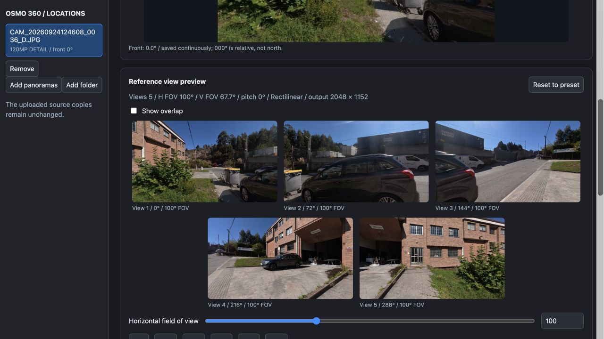
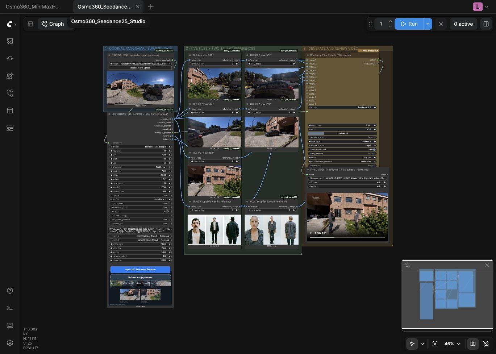

# 360 Scout to Film Consistency

Turn one stitched 360 panorama into overlapping perspective references, then direct a multi-shot scene with Seedance 2.5 or MiniMax H3.

Built by Alvin Cruz for the Open Source Higgsfield challenge, October 2026.

[Watch the 64-second captioned demonstration](https://github.com/Alvinvision/osmo360-reference-studio/blob/main/assets/demo.mp4) · [Download the demo](https://github.com/Alvinvision/osmo360-reference-studio/raw/refs/heads/main/assets/demo.mp4)



## What works

- Four custom nodes and an interactive browser panel inside ComfyUI.
- Shared front direction, horizontal FOV, pitch, roll, view count and output size.
- Rectilinear and General Panini (Natural Wide) projections using the same planner for previews and exports.
- Batch processing, paired captures, overlap review, clean PNGs, contact sheets, prompts, manifests and ZIP downloads.
- Separate Seedance 2.5 and MiniMax H3 graphs: five location views plus two user-supplied identity references.
- Completed ten-second model demonstrations; generated spatial consistency varies by run.

## Install in an existing ComfyUI

Use a recent ComfyUI installation that includes the Seedance 2.5 and MiniMax H3 partner nodes. Tested with ComfyUI 0.43.0, frontend 1.57.4, Python 3.12.16 on Apple Silicon macOS. The extractor uses CPU projection and does not require a local video model or GPU. Other platforms have not been tested.

1. Download or clone this repository.
2. Copy `custom_nodes/comfyui_osmo360` into your `ComfyUI/custom_nodes/` directory.
3. Install its requirements with the Python interpreter used by ComfyUI:

```sh
python -m pip install -r custom_nodes/comfyui_osmo360/requirements.txt
```

4. Restart ComfyUI, then refresh its browser page.
5. Generate the included synthetic example, replacing `/path/to/ComfyUI` with your actual installation:

```sh
python scripts/make_demo_panorama.py /path/to/ComfyUI/input/osmo360/demo_panorama.png
```

6. Drag `workflows/Osmo360_Extraction_Review.json` onto ComfyUI. Run it to extract five views and a contact sheet. Open **360 Reference Extractor** on its extractor node to change camera settings, import your own 2:1 panorama and export a ZIP. This extraction-only graph makes no paid API call.

## Generate video

Import either `Osmo360_Seedance25_Studio.json` or `Osmo360_MiniMaxH3_Studio.json`. Select or upload your panorama in the original panorama node. Open the extractor panel and upload two identity reference images under its talent controls. Keep five location views first, followed by talent A and talent B. Do not run the video graph with missing talent inputs.

Click **Refresh image previews** to check the local reference path. Authenticate with ComfyUI and use a funded workspace before pressing **Run** for the full graph. Partner model generation requires internet access and consumes Comfy credits. Image references and prompts are sent to the selected provider. Model availability and pricing are controlled by Comfy and its providers.

The video nodes use Comfy's current dynamic input schema. The included frontend restores the serialized reference connections after loading. If a graph reports a missing partner node, update ComfyUI and verify partner-node availability for your account. Use the standard Save Video node to play or download the result.



## Verify

From the repository root, with dependencies and ComfyUI's torch/aiohttp available:

```sh
PYTHONDONTWRITEBYTECODE=1 python -m unittest discover -s custom_nodes/comfyui_osmo360/tests -v
```

Thirteen backend checks passed on the development Mac. Tests cover projection, seams, profiles, tensor selection, complete exports, source preservation, confined paths, concurrent previews and cancellation. Real-image comparisons against the native V3 renderer had mean RGB errors below 0.36/255 across seven cases.

## Limits and licenses

This is a local/self-hosted custom pack. It has not been deployed to official Comfy Cloud; importing a workflow does not install a custom node pack there. Panoramas supply image references, not measured 3D geometry. Camera translation, performer identity, exact shot timing and unseen surfaces remain generative. HDR metadata is not automatically detected; exports are SDR RGB and pairing does not fuse HDR.

Original code is MIT licensed; adapted Comfy workflow templates retain their MIT notice in `TEMPLATE_LICENSE`. Third-party models and services retain their own licenses and terms. Example screenshots and the demonstration video are review media and are excluded from the software MIT grant. Private source panoramas and performer source images are not distributed. Use your own permitted inputs or the included synthetic panorama.
