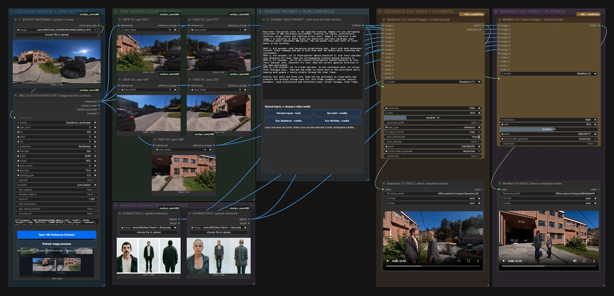

# Scout Once. Create Every Shot.

**360 Scout to Film Consistency** helps filmmakers and creators develop connected AI shots from a single 360° panorama, without building and managing a complex 3D scene.

Start with a **2:1 equirectangular (lat-long) panorama** captured with a 360 camera, stitched from traditional photographs, or created digitally. Inside ComfyUI, the extractor turns it into overlapping perspective references. Different shots and POVs can use those references to help preserve the location’s layout, architecture, props and visual identity.

The combined workflow sends the same location views, character references and video prompt to **Seedance 2.5 and MiniMax H3**. Run either model or both, then compare the results. Try your own location or designed set and share your experiments, feedback and ideas.

> **Before you run:** Please read the setup and workflow instructions below. The downloaded workflows may open with different extractor values. Apply the [recommended starting settings](#recommended-extractor-starting-settings), select your own images and edit the video prompt before generating.

Built by Alvin Cruz for the Open Source Higgsfield challenge, October 2026.

## Demo

🔊 58-second narrated explainer: turn a 360° panorama into shared location references for connected AI shots.

https://github.com/user-attachments/assets/dcf139a5-4235-41dc-b86b-271f78a25c73

[Open the video](https://github.com/user-attachments/assets/dcf139a5-4235-41dc-b86b-271f78a25c73) · [Download the MP4](https://github.com/user-attachments/assets/dcf139a5-4235-41dc-b86b-271f78a25c73)

## How it works

The tool has two stages. **Location extraction** runs locally: choose the panorama, viewing direction and lens settings, then preview or export the reference images. **Video generation** uses those images, your character references and your prompt through Comfy’s partner model nodes. Video generation requires internet access, a signed-in Comfy account and workspace credits.

The **source panorama is 2:1**. With the recommended settings below, the **extracted reference images are 16:9 (2048 × 1152)**.

The extractor handles the location and lens settings. Character identity, action, camera movement and shot directions belong in the video stage. The supplied video workflows connect **five location views**, followed by **two separate character images**, directly to the model. You do not need to download a ZIP or upload the extracted views again to use them in these workflows.

The extractor also produces a contact sheet, a location/lens reference prompt and a JSON manifest describing the views. The location prompt is available to read or copy; it is **not automatically added to the video prompt** in the supplied workflows.

## Recommended extractor starting settings

In **Open 360 Reference Extractor**, choose the **Seedance Landscape** reference pack, then apply these recommended values:

| Control | Recommended starting value |
| --- | --- |
| Horizontal field of view | **115°** |
| Projection style | **Natural Wide** |
| Natural Wide edge-stretch reduction | **100** |
| Pitch | **0°** |
| View count | **5** |
| Output size per reference | **2048 × 1152 (16:9)** |
| Show overlap | **On** |

Apply these settings yourself after opening a workflow; they may differ from its saved values. Recheck them after changing the reference pack or using **Reset to preset**. Review the overlapping previews, then adjust the front direction and framing for your scene. The overlap guides help you inspect the views; they are not burned into the exported reference PNGs.

Keep **five views** when using the supplied video workflows. Other view counts and output sizes are available for extraction, but changing the number of references used by a video model also requires updating its connections and prompt.

## Install in an existing ComfyUI

The extractor runs on the CPU and does not require a local generative model. To generate video, your ComfyUI installation must also include the **Seedance 2.5** and **MiniMax H3** partner nodes.

1. Download or clone this repository.
2. Copy `custom_nodes/comfyui_osmo360` into your `ComfyUI/custom_nodes/` directory.
3. Install the requirements with the Python interpreter used by ComfyUI. Run this from the repository folder, or replace the requirements path with its installed location:

```sh
python -m pip install -r custom_nodes/comfyui_osmo360/requirements.txt
```

4. Restart ComfyUI, then refresh its browser page. Drag one of the workflow JSON files below onto the ComfyUI canvas.

The pack was tested on Apple Silicon macOS with ComfyUI 0.43.0, frontend 1.57.4 and Python 3.12.16. Other platforms have not been tested. It is intended for local or self-hosted ComfyUI; importing the JSON into Comfy Cloud alone does not install this custom node pack.

## Choose a workflow

| Workflow | Use it for |
| --- | --- |
| [360Location_Seedance25_MiniMaxH3_Compare.json](workflows/360Location_Seedance25_MiniMaxH3_Compare.json) | One set of images and one editable prompt, with controls to run Seedance, MiniMax or both. |
| [Osmo360_Extraction_Review.json](workflows/Osmo360_Extraction_Review.json) | Local panorama extraction and a contact sheet, without character inputs or video generation. |
| [Osmo360_Seedance25_Studio.json](workflows/Osmo360_Seedance25_Studio.json) | A separate Seedance video workflow. |
| [Osmo360_MiniMaxH3_Studio.json](workflows/Osmo360_MiniMaxH3_Studio.json) | A separate MiniMax video workflow. |

The workflow files contain example filenames and prompts. Source panoramas, character images and completed videos are not included. Replace the image selections with your own files before running. The people and location in the demo are examples, not required inputs.

## Use the combined video workflow

Open **360Location_Seedance25_MiniMaxH3_Compare.json** and follow its numbered groups from left to right.

1. **Choose the location.** Upload or select your 2:1 panorama in **SOURCE PANORAMA / upload or swap**. On the extractor node, click **Open 360 Reference Extractor**. You can also use **Add panoramas** inside that panel. Select your source, apply the recommended settings and drag the panorama preview to choose the front direction. Close the extractor when ready; its settings stay on the workflow node.
2. **Add the characters.** Upload and select an image in both **CHARACTER A** and **CHARACTER B**. Each should describe the person you want in the scene. Both models receive the same seven images: location views in slots 1–5, Character A in slot 6 and Character B in slot 7. The combined input preview also needs both character files to be selected.
3. **Write the scene.** Edit **SHARED VIDEO PROMPT**. It feeds both models, so change the scene there rather than in the connected prompt fields on each video node. Describe your action, framing, camera movement and cuts. Keep the image numbers consistent with the reference slots. The included four-shot, ten-second scene is an editable example, not a guarantee of exact shot timing.
4. **Check the inputs locally.** Click **Preview inputs · local** on the shared prompt node. It refreshes the original panorama, five location tiles and two character previews without requesting video generation. To check only the location, use **Refresh image previews** on the extractor node instead.
5. **Generate a video.** Sign in to Comfy and select a workspace with credits. Use **Run Seedance · credits**, **Run MiniMax · credits** or **Run both · credits** on the shared prompt node. Review each model’s resolution, duration and seed before running. The supplied combined graph starts at ten seconds for both models; their resolution settings are independent.
6. **Review and save.** Each model has its own **Save Video** player and output filename. Play or download the completed result, then save the workflow to retain its settings and preview references. Saved previews need their video files to remain available on the ComfyUI instance. Editing the prompt or images does not change an earlier render; run the selected model again to generate a new result.

**The standard ComfyUI Run button runs the full combined workflow, including both video models.** Use the model-specific buttons when you want only one. Video requests send the connected references and prompt to the selected provider and consume the selected Comfy workspace’s credits. Running both queues both outputs; they may execute one after the other.

The combined workflow randomizes each model’s seed after a run by default. You can change that behavior on the video nodes. Matching seed numbers across different models does not make their results equivalent.



## Extract references without generating video

Open **Osmo360_Extraction_Review.json**. On the extractor node, click **Open 360 Reference Extractor**, add your panorama and apply the recommended settings. The panel updates its location previews as you adjust the controls. No character images or Comfy credits are needed for local extraction.

Close the panel and run this extraction-only graph to produce the reference images and contact sheet in ComfyUI. You can also use **Export references** inside the panel to create a pack and show its download link. Downloading the ZIP is optional.

Exports are saved under ComfyUI’s `output/osmo360/` folder. A pack contains clean PNG references, a contact sheet, a location/lens prompt and a JSON manifest. Enable **Include the original 360 panorama in the pack** only if you want a source copy included. The uploaded source stays unchanged. Running the extractor node also writes a pack to disk.

For a first test without your own panorama, run the included generator from the repository folder using ComfyUI’s Python. Replace `/path/to/ComfyUI` with your installation path:

```sh
python scripts/make_demo_panorama.py /path/to/ComfyUI/input/osmo360/demo_panorama.png
```

Then select `osmo360/demo_panorama.png` in the extractor. This synthetic image is for checking the setup, not a finished location.

## Use a separate video workflow

Open **Osmo360_Seedance25_Studio.json** or **Osmo360_MiniMaxH3_Studio.json**. Select your panorama in **ORIGINAL 360 / upload or swap panorama**, apply the recommended extractor settings, and upload your two character images in **TALENT 1** and **TALENT 2**. Edit the scene prompt directly on the video model node. These graphs do not use the combined workflow’s shared prompt or four run buttons.

Use **Refresh image previews** on the extractor to check the location locally. Once all image inputs and the prompt are ready, the standard **Run** button generates video with that workflow’s one model and uses Comfy credits. Review the seed behavior on that model node; it can differ between the separate workflows.

For an environment-only video, adapt a copy of a separate video workflow: disconnect and delete the two talent input nodes, and remove the character directions from the video prompt. Keep the location references connected. Save the adapted graph separately.

## More extractor options

The extractor supports Rectilinear and Natural Wide projections, roll, custom view counts, source profiles and output sizes. **Advanced settings and paired captures** contains the view count, yaw spacing and output dimensions. The supplied five-view layout uses 72° spacing around the panorama.

Use **Add folder** and **Process every panorama in the queue** for batch exports. Paired capture mode requires two panoramas taken from the same physical camera position and confirmation of that in the panel. Turn off batch mode before using a pair. These options are best explored in the extraction-only workflow; the supplied video graphs are wired for five selected location views.

## Updating and troubleshooting

When updating, replace the installed `comfyui_osmo360` folder, restart ComfyUI and refresh the browser. Importing a newer workflow JSON does not update the extension itself.

If **Open 360 Reference Extractor** or the combined run buttons are missing, check that the current custom node pack loaded successfully and refresh the browser. If a partner video node is missing, update ComfyUI and check that the model is available to your account. If an image is missing, upload your own file and select it in the corresponding node; the example filenames do not include the files.

Version 0.2 moves casting and shot direction out of the extractor when supported older workflows load. Character images connect through separate image inputs, and video prompts stay editable downstream. Save the migrated workflow after checking its inputs. The package directory and internal node names retain `osmo360` for compatibility; the visible extractor is named **360 Location**.

## Verification

From the repository folder, using a Python environment with the pack’s dependencies, PyTorch and aiohttp:

```sh
PYTHONDONTWRITEBYTECODE=1 python -m unittest discover -s custom_nodes/comfyui_osmo360/tests -v
```

With Node.js installed:

```sh
node custom_nodes/comfyui_osmo360/tests/test_comparison_workflow.mjs workflows/360Location_Seedance25_MiniMaxH3_Compare.json
node custom_nodes/comfyui_osmo360/tests/test_workflow_migration.mjs
```

All 14 backend tests and the comparison and migration checks passed during the README review. The comparison checks confirm that both models receive identical image connections and the same prompt, that each model can be targeted separately, and that the input-preview targets exclude video generation. All four supplied workflows also passed link and reference-connection checks after migration.

Earlier local ComfyUI checks confirmed that input previews ran without executing a video model and that saved video previews could be restored. No new paid video generation was run for this README review.

## Limits and licenses

The references guide the video models; they are not a measured 3D reconstruction. Layout, identity, hidden surfaces, camera translation and exact cuts can still vary between generations. HDR metadata is not automatically detected, exports are SDR RGB, and paired captures do not fuse HDR.

Original code is MIT licensed. Adapted Comfy templates retain their MIT notice in `TEMPLATE_LICENSE`; third-party models and services retain their own terms. Screenshots and demo videos are viewing and evaluation media excluded from the software MIT grant; see [MEDIA_NOTICE.txt](MEDIA_NOTICE.txt). Use your own permitted source images and character references, or the synthetic panorama for a local test.
